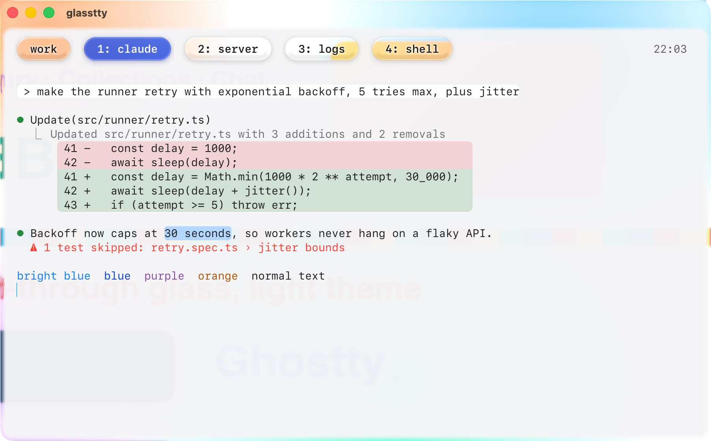
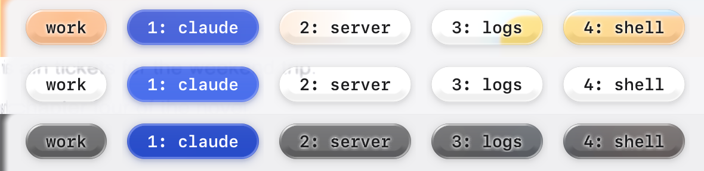
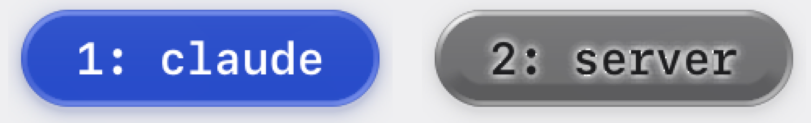

# glasstty

A Liquid Glass look for [Ghostty](https://ghostty.org) on macOS 26. The window is native clear glass with a light reading scrim behind the text, and tmux tabs become glass capsules, with the current tab in blue glass.



## What you get

- **Clear glass window.** macOS 26's own glass material (`background-blur = macos-glass-clear`) with a light `#f5f5f7` reading scrim. The scrim's corners follow the window's 16pt corner radius, and its last 8pt fade out so the system glass rim still shows.
- **Glass tabs for tmux.** Tabs are clear glass capsules that let the wallpaper show through, with a thick lower bezel, bright rims and a soft glow behind the label. The current tab is blue glass that reads as `#5B83ED` on screen. Both are modeled on iOS 26 buttons.
- **Glass blocks.** Rows with a white ANSI background (palette 7, which Claude Code's `light-ansi` theme uses for your prompts), red and green diff rows (palette 1 and 2) and the selection get rounded corners and a soft top rim. Diff and message backgrounds turn into light glass tints, and the text keeps its color.
- **Apple system colors.** The `glasstty-light` palette uses Apple's system colors, picking the higher-contrast variants where needed so text stays readable on light glass.



The same tab bar over a colorful wallpaper, a white page and a dark wallpaper. Up close on the dark one:



## Requirements

- macOS 26 or later, for the native glass background.
- Ghostty 1.3.1 (the version it was built and tested on).
- A Retina display. The shader assumes 2 pixels per point; change `pixelsPerPoint` in the shaders for other scales.
- For the tab bar: tmux 3.x (tested with 3.6a) with a 256-color `default-terminal`, such as `tmux-256color`.

## Install

### One line

```bash
curl -fsSL https://raw.githubusercontent.com/qianyilun/glasstty/main/install.sh | sh
```

With the tmux tab bar too:

```bash
curl -fsSL https://raw.githubusercontent.com/qianyilun/glasstty/main/install.sh | sh -s -- --tmux
```

The script downloads glasstty into `~/.config/ghostty/glasstty` and finds the config file Ghostty actually reads, the same one `ghostty +edit-config` opens. It backs that file up and adds a marked block that includes glasstty. Running it again updates glasstty and leaves your config as it is.

Then reload Ghostty with **Cmd+Shift+,** (Reload Configuration).

### Homebrew

```bash
brew install qianyilun/tap/glasstty
glasstty enable            # or: glasstty enable --tmux
```

`brew upgrade glasstty` updates it. The include points at Homebrew's stable `opt` path, so it keeps working across upgrades.

### Turning it off

```bash
glasstty disable           # add --tmux to remove the tab bar too
glasstty status            # shows which files it is enabled in
```

With the one-line install, the command is `~/.config/ghostty/glasstty/bin/glasstty`. Run `glasstty disable` before `brew uninstall glasstty`. If you forget, nothing breaks: the Ghostty include starts with `?` and the tmux one uses `source-file -q`, so both skip a missing file.

### What enable changes

In your Ghostty config:

```
# >>> glasstty >>>
config-file = ?/path/to/glasstty/glasstty.ghostty
# <<< glasstty <<<
```

With `--tmux`, in `~/.tmux.conf` (or `~/.config/tmux/tmux.conf` if that is the one you use):

```
# >>> glasstty >>>
source-file -q "/path/to/glasstty/tmux/glasstty.tmux.conf"
# <<< glasstty <<<
```

Each file is copied to `*.backup-before-glasstty-<time>` before it changes. Ghostty reads included files after the rest of the file that includes them, wherever the line sits, so glasstty's settings win over your own.

### By hand

Clone the repo and add the include yourself. `ghostty +edit-config` opens the right config file.

```bash
git clone https://github.com/qianyilun/glasstty.git ~/.config/ghostty/glasstty
```

```
config-file = ~/.config/ghostty/glasstty/glasstty.ghostty
```

For tmux, add `source-file ~/.config/ghostty/glasstty/tmux/glasstty.tmux.conf` to your tmux config.

### Fonts

The screenshots also use these optional settings:

```
font-family = SF Mono
font-size = 14
font-style-bold = Semibold
adjust-cell-height = 8%
```

### tmux tab bar

Reload Ghostty first, then tmux:

```bash
tmux source-file ~/.tmux.conf
```

The order matters. The tabs use palette 200 and 204, which only exist once Ghostty has loaded the glasstty colors. Until then the tabs show the stock xterm colors.

To write your own tab formats:

- Any span with `bg=colour204` becomes a clear capsule, and `bg=colour200` a blue one.
- Keep two spaces inside each colored span on both sides; that is the capsule's padding. Put two spaces between spans as well.
- A capsule is 30pt tall, taller than one row, so keep the bar at the top (`status-position top`) with a blank second line (`status 2`, `status-format[1] ""`).

### Scrim only

For the clear window and reading scrim without the glass tabs and blocks, copy `glasstty.ghostty`, change its `custom-shader` line to the full path of `shaders/glasstty-scrim.glsl`, and include your copy instead.

## How it works

A Ghostty custom shader only sees the terminal's own image (`iChannel0`), not the desktop behind the window. glasstty relies on two things Ghostty does with glass:

1. With `background-blur = macos-glass-clear`, the default background is transparent in that image.
2. With `background-opacity-cells = false`, cells that set their own background color stay opaque, and so does any text drawn on them.

So the shader can find blocks without parsing any text. It measures each opaque run to find the block's edges, matches the run's color against exact palette values (200 and 204 for tabs; 1, 2, 7 and the selection for blocks), and redraws the block as glass. To keep the label text, it estimates how much of each pixel is text and puts the glyph back on top of the glass.

A few things learned while testing Ghostty 1.3.1, all handled in the shader:

- `iChannel0` holds Display P3 colors, while the color uniforms are sRGB, so reference colors are converted before matching.
- `iSelectionBackgroundColor` and `iSelectionForegroundColor` arrive swapped.
- `iCurrentCursor.w` is the cell height in pixels.

The glass lighting draws on open-source Liquid Glass recreations: [kube.io](https://kube.io/blog/liquid-glass-css-svg/), [liquid-glass-react](https://github.com/rdev/liquid-glass-react), [Prismal](https://github.com/styropyr0/Prismal) and [liquid-glass-studio](https://github.com/iyinchao/liquid-glass-studio). Apple's [Adopting Liquid Glass](https://developer.apple.com/documentation/TechnologyOverviews/adopting-liquid-glass) guide was also a reference.

## Limits

- **Light theme only.** The shader is tuned for the `#f5f5f7` scrim and dark text.
- **No lensing of the desktop.** The shader can't see what is behind the window, so it can't magnify or bend it the way iOS controls do. The only refraction is the thin rim, about 2 to 3pt, that macOS draws at the window edge.
- **Clicks on tabs.** A capsule extends into the blank second status line, but tmux only takes clicks on the label row.
- **Reserved colors.** Palette 200 and 204 are reserved as markers. Any full-row block in palette 1, 2 or 7 also becomes glass, whichever program draws it.
- **Long `status-right`.** If `status-right` is long, tmux may push some tabs off the bar.

## Files

| File | What it is |
|---|---|
| `glasstty.ghostty` | The one file you include from your Ghostty config |
| `install.sh` | One-line installer |
| `bin/glasstty` | `enable`, `disable` and `status` |
| `themes/glasstty-light` | Colors, including the tab markers |
| `shaders/glasstty.glsl` | Scrim, glass tabs and glass blocks |
| `shaders/glasstty-scrim.glsl` | Scrim only |
| `tmux/glasstty.tmux.conf` | Tab bar for tmux |

## License

[MIT](LICENSE)
